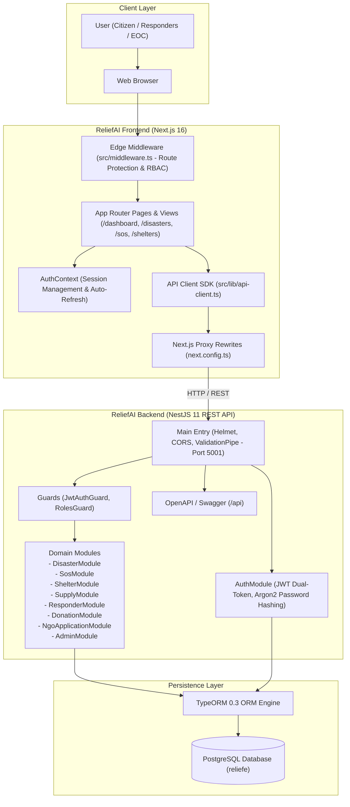

# ReliefAI

An AI-powered disaster response and emergency management platform for Bangladesh.

[](https://nextjs.org/)
[](https://react.dev/)
[](https://www.typescriptlang.org/)
[](https://tailwindcss.com/)
[](https://nestjs.com/)
[](https://www.postgresql.org/)
[](https://typeorm.io/)
[](https://jwt.io/)

---

## Live Demo

- **Frontend Application:** [https://relief-ai-azure.vercel.app/](https://relief-ai-azure.vercel.app/)
- **Backend Swagger API Documentation:** `http://localhost:5001/api` (Local development instance)

---

## Table of Contents

- [Project Overview](#project-overview)
- [Features](#features)
- [System Architecture](#system-architecture)
- [Tech Stack](#tech-stack)
- [Authentication & Security](#authentication--security)
- [Project Structure](#project-structure)
- [Installation & Setup](#installation--setup)
- [Environment Variables](#environment-variables)
- [API Integration](#api-integration)
- [Screenshots](#screenshots)
- [Future Improvements](#future-improvements)
- [Developer Information](#developer-information)

---

## Project Overview

Bangladesh is among the most climate-vulnerable countries in the world. It regularly faces extreme weather phenomena, including flash floods across the Surma-Meghna-Jamuna river basins, severe tropical cyclones originating in the Bay of Bengal, and monsoon landslides. 

### Disaster Response Challenges

During catastrophic climate events, humanitarian operations face critical operational bottlenecks:
- **Fragmented Communication:** Citizen distress messages are scattered across disconnected social media channels and unverified phone calls.
- **Triage and Prioritization Delays:** Emergency dispatchers struggle to classify the severity of incoming distress reports under high volume.
- **Siloed Agency Operations:** Government agencies, armed forces rescue divisions, non-governmental organizations (NGOs), and community volunteers often operate without a shared tactical operating picture.
- **Logistical Inefficiencies:** Real-time visibility into emergency shelter occupancy and relief supply stockpiles is frequently missing or delayed.

### The ReliefAI Solution

ReliefAI addresses these challenges by providing a unified emergency management platform tailored for all disaster response stakeholders:
- **Citizens:** Quickly broadcast one-touch GPS-tagged SOS emergency alerts, discover nearby shelters with real-time occupancy data, and track emergency updates.
- **Rescue Teams:** Access prioritized distress queues scored by urgency, view victim coordinates and medical requirements, and update dispatch status in real time.
- **NGOs:** Apply for accredited relief participation, manage warehouse relief inventory, track aid convoy distribution, and log transparent donations.
- **Government & Emergency Operations Centers (EOC):** Monitor nationwide disaster telemetry, oversee multi-agency resource allocations, and manage user access control across jurisdictions.

---

## Features

### Authentication & Access Control
- **Account Registration & Login:** Full registration and authentication flow with credential validation and session persistence.
- **Dual-Token JWT Security:** Short-lived access tokens paired with long-lived refresh tokens for secure and seamless session renewal.
- **Edge Route Protection:** Next.js middleware guards that validate JWT signatures and clearance levels before route rendering.
- **Role-Based Access Control (RBAC):** Server-enforced permissions governing API endpoints and dashboard views.

### User Roles & Specialized Dashboards
ReliefAI implements seven distinct role clearances, each with dedicated dashboard views and operational scopes:
- **Admin:** Manages platform users, reviews NGO applications, oversees system telemetry, and configures national operational sectors.
- **Super Admin:** Executive governance with unrestricted access to strategic disaster management and system controls.
- **Government:** Inter-agency emergency operations center overview, national hazard statistics, and strategic logistics requisition.
- **NGO:** Humanitarian relief inventory management, warehouse distribution logs, and donation tracking.
- **Rescue Team:** Tactical search-and-rescue (SAR) dispatch console, field triage status updates, and incident response tracking.
- **Volunteer:** Community-level disaster reporting, local task coordination, and evacuation assistance.
- **Citizen:** One-touch SOS beacons, personal distress status history, and regional shelter capacity search.

### Disaster Management
- **National & Regional Monitoring:** Centralized registry of active disasters (floods, cyclones, landslides, waterlogging) with geographic categorization.
- **Severity Classification:** Multi-tier severity metrics (Critical, High, Moderate, Low) displaying casualties, affected population estimates, and risk zones.
- **Geographic Records:** Coordinates, affected districts, and operational zones mapped to national disaster response grids.

### Emergency SOS System
- **Distress Beacon Submission:** Instant SOS dispatch capturing user coordinates, contact details, number of trapped individuals, and situational tags (e.g., medical emergency, rising water level, elderly/infants present).
- **Urgency Scoring Engine:** Algorithmic calculation of incident urgency to ensure high-risk cases are triaged to the top of rescue queues.
- **Rescue Workflow:** Incident status lifecycle (`pending` -> `assigned` -> `in_progress` -> `resolved` -> `cancelled`) with responder assignment and estimated arrival tracking.

### Shelter Management
- **Shelter Directory:** Comprehensive inventory of designated cyclone and flood shelters across vulnerable divisions (Sylhet, Chittagong, Barisal, Khulna).
- **Capacity Tracking:** Live occupancy counts against total capacity, displaying real-time utilization percentages.
- **Facility Verification:** Availability indicators for clean drinking water, backup generator power, and emergency medical supplies.

### Supply Management
- **Relief Inventory Tracking:** Granular monitoring of stockpiled resources across multiple categories (Medical Supplies, Water Purification, High-Discharge Pumps, Dry Rations, Rescue Boats).
- **Stock Movement Operations:** Dedicated dispatch and restock workflows with minimum threshold warnings.

### Responder Management
- **Tactical Teams Directory:** Personnel and unit tracking for organizations such as Fire Service & Civil Defence (FSCD), Bangladesh Red Crescent Society (BDRCS), Armed Forces Division (AFD), and Cyclone Preparedness Programme (CPP).
- **Readiness Tracking:** Real-time operational statuses (`available`, `deployed`, `en_route`, `standby`).
- **Zone Assignments:** Assigned operational sectors and primary response capabilities (Swift Water Rescue, Medical First Aid, Evacuation Marshalling).

### Donation System
- **Transparent Aid Ledger:** Record of public and institutional contributions mapped to specific relief causes (e.g., Sylhet Flash Flood Relief, Cyclone Emergency Fund).
- **Impact Tracking:** Clear association between donated funds and verifiable humanitarian output (family food packs delivered, water purification kits distributed).
- **Verification Records:** Automated generation of transaction hashes for auditable financial transparency.

### NGO Application Workflow
- **Accreditation Submission:** Standardized registration interface for non-governmental organizations to submit registration numbers, operational focus areas, and focal person contact data.
- **Administrative Review:** Dedicated administrative workflow to inspect, verify, approve, or reject pending NGO applications with custom administrative notes.
- **Automated Provisioning:** Approved applications automatically provision accredited NGO credentials.

---

## System Architecture



---

## Tech Stack

### Frontend
- **Framework:** Next.js 16 (App Router with Server and Client Components)
- **Library:** React 19
- **Language:** TypeScript 5
- **Styling:** Tailwind CSS v4
- **State & Context:** React Context API (`AuthContext`)
- **Icons & Visualization:** Lucide React, Recharts
- **Forms & Validation:** React Hook Form, Zod

### Backend
- **Framework:** NestJS 11
- **Database ORM:** TypeORM 0.3
- **Database:** PostgreSQL 16
- **Authentication:** JWT (JSON Web Tokens) with Passport
- **Cryptography:** Argon2id password hashing
- **Security:** Helmet, CORS, Class-Validator, Class-Transformer

### Development & Tooling
- **Version Control:** Git, GitHub
- **Containerization:** Docker
- **API Documentation:** OpenAPI / Swagger (`/api`)
- **Package Management:** npm (Frontend), pnpm (Backend)

---

## Authentication & Security

ReliefAI implements defense-in-depth principles across both layers of the application:

1. **Dual-Token JWT Architecture:**
   - **Access Token:** Short-lived token transmitted via Authorization Bearer headers and `httpOnly` secure cookies.
   - **Refresh Token:** Long-lived token stored securely to facilitate background token rotation without disrupting active users.
   - **Automatic Refresh Cycle:** The frontend client initiates a background token refresh check every 10 minutes to maintain persistent valid sessions.

2. **Edge Route Protection:**
   - Implemented via Next.js Edge Middleware ([`src/middleware.ts`](file:///c:/Projects/ReliefAI/src/middleware.ts)).
   - Unauthenticated requests targeting private dashboards (`/dashboard/*`, `/command`, `/profile`, `/settings`) are intercepted and redirected to `/auth/login?redirect=<target>`.
   - Authenticated sessions with insufficient permissions are redirected to a dedicated `/403` Access Denied view.

3. **Role-Based Access Control (RBAC):**
   - Endpoints in the NestJS backend are protected by a global `JwtAuthGuard` and domain-specific `RolesGuard`.
   - Access to sensitive operational commands (e.g., user provisioning, incident dispatch, NGO review) requires verified administrative clearance.

4. **Cryptographic Password Protection:**
   - Passwords are encrypted using Argon2id, an industry-standard memory-hard hashing algorithm resistant to GPU-accelerated brute-force attacks.
   - Database entities enforce `{ select: false }` on the `password` field, preventing hashes from being inadvertently exposed in REST responses.

5. **Strict Environment Segregation:**
   - Public frontend variables are explicitly prefixed with `NEXT_PUBLIC_`.
   - Database credentials, token signing keys, and server secrets remain isolated within server-side environment files and are never bundled into client assets.

---

## Project Structure

```
ReliefAI/
├── .env.example              # Sample environment configuration template
├── .env.local                # Local environment variables (git-ignored)
├── next.config.ts            # Next.js configuration and backend API rewrites
├── package.json              # Project dependencies and operational scripts
├── tsconfig.json             # TypeScript compiler settings
├── public/                   # Static assets, branding, and icons
├── src/
│   ├── app/                  # Next.js App Router (Pages & Layouts)
│   │   ├── layout.tsx        # Root HTML layout with providers
│   │   ├── page.tsx          # Public landing and crisis overview page
│   │   ├── 403/              # Access forbidden error view
│   │   ├── auth/             # Authentication routes
│   │   │   ├── login/        # User login portal
│   │   │   ├── register/     # User registration portal
│   │   │   ├── apply-ngo/    # NGO registration portal
│   │   │   ├── forgot-password/
│   │   │   └── reset-password/
│   │   ├── command/          # Unified crisis command center
│   │   ├── dashboard/        # Role-specific operational dashboards
│   │   │   ├── admin/        # Platform administration & user governance
│   │   │   ├── citizen/      # Citizen emergency status & local alerts
│   │   │   ├── government/   # Inter-agency disaster oversight
│   │   │   ├── ngo/          # Relief drives & supply management
│   │   │   ├── rescue/       # Field search-and-rescue dispatch queue
│   │   │   └── volunteer/    # Community relief task tracking
│   │   ├── disasters/        # Live disaster monitoring and severity list
│   │   ├── sos/              # Emergency SOS beacon broadcast portal
│   │   ├── shelters/         # Evacuation shelter directory and capacity HUD
│   │   ├── supplies/         # Humanitarian supply stockpile registry
│   │   ├── responders/       # Tactical rescue teams directory
│   │   ├── donations/        # Public aid donation ledger
│   │   ├── apply-ngo/        # Dedicated NGO accreditation application
│   │   └── profile/          # User profile and credentials settings
│   ├── components/           # Reusable UI and layout components
│   │   ├── Navbar.tsx        # Top navigation with role indicators
│   │   ├── Footer.tsx        # Standard platform footer
│   │   ├── EmergencyBanner.tsx # Live national crisis advisory banner
│   │   ├── FloatingSOS.tsx   # Persistent emergency SOS trigger button
│   │   ├── StatCard.tsx      # Analytical metric counter card
│   │   ├── TacticalMap.tsx   # Geospatial disaster vector visualizer
│   │   ├── analytics/        # Recharts crisis visualization widgets
│   │   └── ui/               # Core atomic UI primitives
│   ├── context/
│   │   └── AuthContext.tsx   # React Authentication Context & Session Provider
│   ├── lib/
│   │   ├── api-client.ts     # Typed REST API Client SDK for NestJS
│   │   ├── types.ts          # Core domain models and TypeScript interfaces
│   │   └── auth.ts           # Authentication helper functions
│   └── middleware.ts         # Edge middleware for RBAC route enforcement
```

---

## Installation & Setup

### Prerequisites
- **Node.js:** `>= 20.9.0` (LTS recommended)
- **Package Manager:** `npm` (Frontend), `pnpm` (Backend)
- **Database:** PostgreSQL instance (running locally or hosted)
- **Backend Service:** Running instance of the ReliefAI NestJS backend on port `5001`

### 1. Clone the Repository
```bash
git clone https://github.com/Wasif109160/ReliefAI.git
cd ReliefAI
```

### 2. Install Dependencies
```bash
npm install
```

### 3. Configure Environment Variables
Create a local environment file based on the provided template:
```bash
cp .env.example .env.local
```

Configure `.env.local` with your backend connection endpoints:
```env
NEXT_PUBLIC_API_URL=http://localhost:5001
INTERNAL_API_URL=http://localhost:5001
NEXT_PUBLIC_APP_URL=http://localhost:3000
```

### 4. Run the Development Server
```bash
npm run dev
```

Open [http://localhost:3000](http://localhost:3000) in your browser to view the application.

### 5. Production Build
To validate TypeScript types and compile the optimized production bundle:
```bash
npm run build
npm run start
```

---

## Environment Variables

| Variable | Scope | Required | Description |
| :--- | :---: | :---: | :--- |
| `NEXT_PUBLIC_API_URL` | Public (Client/SSR) | Yes | URL of the NestJS REST API server (e.g., `http://localhost:5001` or production backend domain). |
| `INTERNAL_API_URL` | Server-Side | Optional | Internal server-to-server API endpoint for Docker or containerized environments. |
| `NEXT_PUBLIC_APP_URL` | Public | Yes | Canonical URL of the frontend application (e.g., `http://localhost:3000`). |
| `NEXT_PUBLIC_OPERATIONAL_SECTOR` | Public | Optional | Identifier for the active response sector (e.g., `BANGLADESH_NATIONAL_GRID`). |
| `NEXT_PUBLIC_MESH_NODE_ID` | Public | Optional | Command node identifier for audit logging (e.g., `BD_DHAKA_CENTRAL_EOC`). |
| `NEXT_PUBLIC_GOOGLE_MAPS_KEY` | Public | Optional | Google Maps JavaScript API key for satellite map layers. Falls back to vector map when unconfigured. |

---

## API Integration

The ReliefAI frontend communicates with the NestJS backend via a centralized, type-safe API SDK located in [`src/lib/api-client.ts`](file:///c:/Projects/ReliefAI/src/lib/api-client.ts).

### SDK Architecture
The API SDK exports modular service clients corresponding to each backend domain:
- `authApi`: Login, registration, token refresh, profile updates, password modification, and logout.
- `userApi`: User management, profile retrieval, and account deletion.
- `disasterApi`: Disaster incident listing, detailed records, and new hazard reporting.
- `sosApi`: Distress beacon creation, urgent incident queries, and SAR team dispatching.
- `shelterApi`: Shelter directory retrieval, facility updates, and occupancy adjustments.
- `supplyApi`: Humanitarian supply queries, inventory restock, and relief dispatch logging.
- `responderApi`: Search-and-rescue team directories and readiness status updates.
- `donationApi`: Aid contribution logging, cause filtering, and impact verification.
- `ngoApi`: NGO registration submission, application review, and verification status.
- `adminApi`: Administrative user provisioning, role adjustments, and platform metrics.

### Request Flow & Proxy Architecture
- **Unified Path Resolution:** The client normalizes endpoints and routes requests through Next.js `beforeFiles` rewrites configured in `next.config.ts`, eliminating cross-origin browser issues during local development.
- **Credential Handling:** Every request automatically attaches credentials (`credentials: 'include'`) and injects the active Bearer token from local storage if available.
- **Error Handling:** API methods return standard `Response` objects or typed errors, enabling clean UI handling of network failures, 401 unauthorized states, and validation warnings.

---

## Screenshots

<!-- Add your screenshots in the /public/screenshots/ folder and update paths below -->

### Home Page


### Command Center Dashboard


### Emergency SOS System


### Disaster Monitoring


### Admin Panel


---

## Future Improvements

1. **Real-Time SOS Dispatch via WebSockets:**
   - Integrate WebSocket (`@nestjs/websockets` / Socket.io) channels for instant, push-based dispatch notifications on responder and EOC dashboards without polling.
2. **AI-Driven Hydrological Flood Modeling:**
   - Implement machine learning models analyzing upstream river basin water levels to predict flash flood arrival times across low-lying districts.
3. **Dedicated Mobile Application:**
   - Develop a lightweight React Native mobile application supporting offline SMS-based SOS beacons for areas with severed mobile data connectivity.
4. **Geospatial Route Optimization:**
   - Incorporate real-time flooded road network data into routing algorithms for rescue boat and relief supply convoys.

---

## Developer Information

**Developer:** T.M. Wasif Jamee  
**GitHub:** [https://github.com/Wasif109160](https://github.com/Wasif109160)  
**LinkedIn:** [https://www.linkedin.com/in/t-m-wasif-jamee-687094297/](https://www.linkedin.com/in/t-m-wasif-jamee-687094297/)

---

## License

This project is maintained for humanitarian disaster response demonstration and portfolio review. Proprietary rights are reserved by the author.
